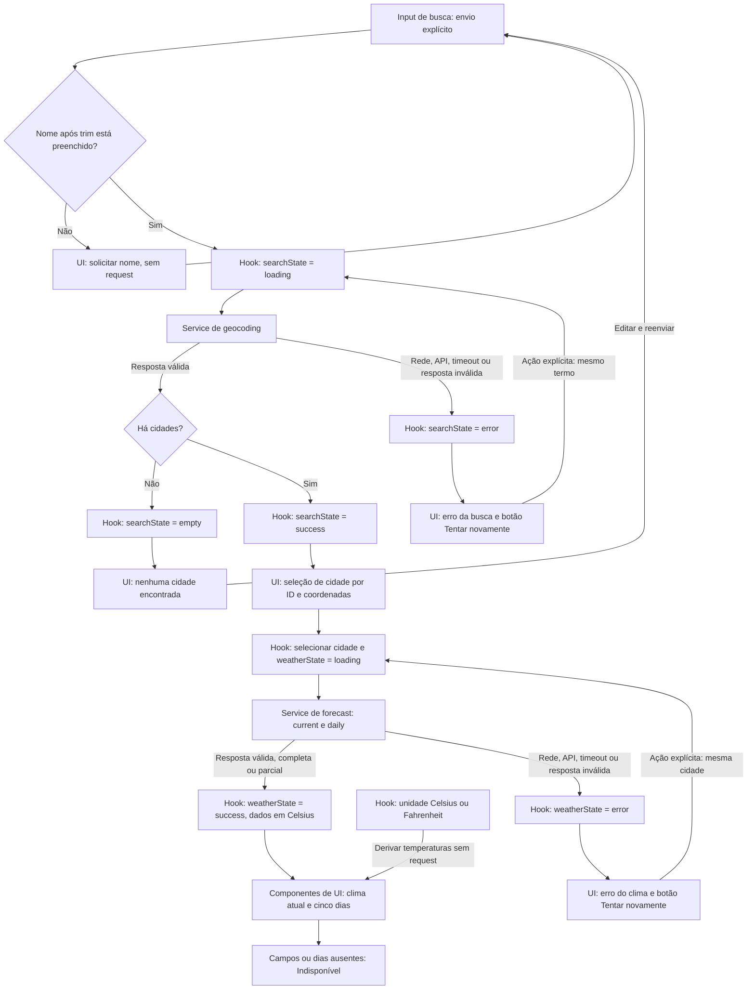

# Plano Técnico — Weather App

Este plano deriva da especificação em [weather-app-spec.md](../specs/weather-app-spec.md). Os requisitos RF, critérios CA e RNF citados abaixo são rastreáveis a essa fonte.

## Architecture

Aplicação cliente React com quatro responsabilidades: apresentação (`components`), orquestração/estado (`hooks`), acesso a dados (`services`) e funções puras (`lib`). A UI não conhece o formato bruto das respostas externas: os serviços validam e convertem os dados da Open-Meteo para os contratos internos.

```text
Busca e seleção ──> hook de consulta ──> serviço de geocodificação ──> Open-Meteo
                           │
                           └──────────> serviço de previsão ─────────> Open-Meteo
                           │
                           └──────────> estado da página ───────────> componentes
```

- Busca explícita por envio, apresentação das localidades e seleção (RF-01, RF-02).
- Consulta de condições atuais e cinco dias de previsão para as coordenadas selecionadas (RF-03, RF-04).
- Conversão de unidade apenas na apresentação; os valores internos permanecem em Celsius (RF-05).
- Interface responsiva, localizada em pt-BR, acessível por teclado e com atribuição da fonte (RF-06, RF-08; RNF-01 a RNF-03).

### Responsabilidades e dependências

| Camada | Responsabilidade | Limite |
|---|---|---|
| `components` | Renderizar dados e estados recebidos por props; emitir ações por callbacks; manter semântica, foco e layout. | Não fazer `fetch`, interpretar JSON da API ou coordenar requisições. Pode usar `lib` para apresentação. |
| `hooks` | Coordenar busca explícita, seleção, carregamento, erros, retry e unidade; cancelar operações substituídas e ignorar respostas obsoletas. | Chamar serviços sem construir URLs nem depender do JSON bruto; não gerar marcação. |
| `services` | Montar URLs, executar HTTP com timeout/cancelamento, validar respostas e entregar `City[]` ou `WeatherData`. | Não importar React, alterar estado da tela ou decidir foco e layout. |
| `lib` | Converter temperaturas, traduzir códigos WMO, formatar datas e normalizar séries em funções puras. | Não acessar rede, DOM, armazenamento ou estado React; receber relógio/data de referência como argumento quando necessário. |
| `types` | Compartilhar os contratos de domínio entre as camadas. | Não executar lógica nem importar componentes, hooks ou serviços. |

`App` compõe os componentes e conecta os dados e callbacks do hook. As dependências seguem `App → hooks → services → Open-Meteo`; componentes e serviços podem reutilizar `lib`, e todas as camadas podem consumir `types`. `lib` não depende das camadas superiores. O serviço aplica as funções puras de normalização; o hook permanece responsável apenas pelo ciclo de vida da operação.

Essa separação isola efeitos colaterais na fronteira HTTP e no ciclo de vida React, sem exigir classes, repositórios genéricos, contextos globais ou injeção de dependências por framework.

## Tech Stack

- **TypeScript strict, React e Vite:** stack definida pelo projeto; tipos e componentes simples para a aplicação cliente.
- **Tailwind CSS:** estilos responsivos e tema do produto, preservando controles acessíveis e alvos de toque de pelo menos 44 × 44 CSS px.
- **Fetch API:** chamadas HTTPS sem chave de usuário; `AbortController` para timeout e cancelamento.
- **Vitest e Testing Library:** testes unitários e de componentes; **Playwright** para fluxos e viewports reais.
- **Biome:** lint e formatação conforme configuração existente.

Não introduzir biblioteca de estado, cliente HTTP ou camada de cache: o escopo cabe nos recursos nativos da plataforma e no estado React.

## Project Structure

Estrutura proposta, alinhada às convenções existentes:

```text
src/
  App.tsx
  main.tsx
  components/
    SearchForm.tsx
    LocationResults.tsx
    CurrentWeather.tsx
    ForecastList.tsx
    ForecastCard.tsx
    TemperatureUnitToggle.tsx
    StatusMessage.tsx
    SourceAttribution.tsx
  hooks/
    useWeatherSearch.ts
  services/
    geocodingService.ts
    weatherService.ts
  types/
    weather.ts
  lib/
    temperature.ts
    format.ts
    weatherCodes.ts
    dateTime.ts
    normalizeWeather.ts
tests/
  unit/
  e2e/
```

`main.tsx` inicializa React; `App.tsx` compõe a página. `lib/temperature.ts` converte e formata temperaturas; `lib/weatherCodes.ts` mapeia WMO para rótulos pt-BR e ícones decorativos; `lib/dateTime.ts` trata datas locais e formatação; `lib/normalizeWeather.ts` transforma a resposta meteorológica validada em condições atuais e cinco entradas diárias. A validação do payload externo e o mapeamento simples da geocodificação permanecem junto aos respectivos serviços, sem criar um arquivo para cada pequena transformação.

As pastas propostas são fronteiras de responsabilidade, não novas camadas de execução. Não criar arquivos vazios preventivamente: introduzir cada módulo quando a tarefa correspondente exigir. Localizar os testes seguindo a organização já adotada pelo repositório, sem duplicar convenções.

## Data Model

Contratos internos sugeridos. Valores numéricos de clima são anuláveis para representar campos ausentes sem convertê-los em zero (CA-03b, CA-04b).

```ts
type Unit = "celsius" | "fahrenheit";

interface City {
  id: number;
  name: string;
  country: string;
  admin1?: string;
  latitude: number;
  longitude: number;
  timezone?: string;
}

interface CurrentWeather {
  temperatureC: number | null;
  weatherCode: number | null;
  relativeHumidity: number | null;
  windSpeedKmh: number | null;
  precipitationMm?: number | null;
  pressureHpa?: number | null;
  observedAtLocal: string | null;
}

interface ForecastDay {
  date: string; // Data local ISO yyyy-MM-dd
  weatherCode: number | null;
  temperatureMinC: number | null;
  temperatureMaxC: number | null;
  precipitationProbability?: number | null;
}

interface WeatherData {
  city: City;
  timezone: string;
  current: CurrentWeather;
  forecast: ForecastDay[]; // Exatamente cinco datas locais, em ordem
}
```

Resultados da busca são identificados por identidade geográfica — coordenadas e, quando disponível, o ID da fonte — e não pelo texto do rótulo. `admin1` é opcional; não renderizar região vazia. `weatherCode` é interpretado por um mapeamento local de códigos WMO para rótulos em pt-BR, com fallback explícito de indisponibilidade para códigos não reconhecidos. Valores de temperatura permanecem em Celsius e são arredondados a uma casa decimal depois da conversão para exibição.

Precipitação (`precipitationMm`, mm) e pressão à superfície (`pressureHpa`, hPa)
são opcionais para preservar os consumidores existentes. A UI mostra
“Indisponível” para ausência, `null` ou número não finito. Quando a integração
for implementada, mapear `current.precipitation` e `current.surface_pressure`
sem confundir pressão à superfície com pressão ao nível do mar. O mock inclui
essas métricas; esta etapa não adiciona acesso à API.

`ForecastDay.precipitationProbability` é opcional, em %, para compatibilidade
com previsões existentes. Ausência, `null`, valores não finitos ou fora de
0–100 são exibidos como “Indisponível”. Na futura integração, mapear
`daily.precipitation_probability_max` por data; não deduzir probabilidade do
código WMO ou da quantidade de precipitação.

`ForecastList` recebe `forecast: ForecastDay[]` normalizado e `unit: Unit`;
preserva a ordem recebida e delega cada entrada a `ForecastCard`, com props
`day: ForecastDay` e `unit: Unit`. A normalização das cinco datas continua
na camada de dados. Lista vazia mostra mensagem explícita. O grid usa
`grid-cols-2 sm:grid-cols-3 lg:grid-cols-5`.
`lib/format.ts` fornece `formatDay(date)` (dia da semana e `dd/MM/yyyy` em
pt-BR, independente do fuso do dispositivo) e a formatação da probabilidade.
Não depende do relógio global nem tenta inferir “hoje”.

## Data Flow



O hook orquestra as chamadas e recebe seus resultados; as setas representam eventos e dados, não chamadas diretas entre componentes e serviços. Os estados `loading` são apresentados na UI. Antes de aplicar sucesso ou erro, o hook verifica a identidade da operação: respostas obsoletas são ignoradas e cancelamentos por substituição não geram erro visível.

1. A pessoa envia a busca. Remover espaços externos; se ficar vazia, mostrar orientação e não chamar o serviço (RF-01, CA-01a–c).
2. O hook ativa o estado de carregamento e solicita localidades ao serviço de geocodificação. Resultados preservam a consulta associada e são exibidos como texto, sem interpretar HTML (CA-01b, RNF-06).
3. Sem resultados, informar ausência de correspondências e manter a consulta editável (CA-07b). Com resultados, exibir nome, país e região quando disponível.
4. Ao selecionar uma opção, o serviço meteorológico usa suas coordenadas e solicita condições atuais e previsão. A resposta é normalizada no modelo interno; nenhuma consulta ocorre para resultados não selecionados (RF-02, RF-03, RF-04).
5. A previsão usa as datas locais retornadas pela API, preservando a sequência de hoje mais quatro dias. Ausências são preenchidas como campos nulos nas datas esperadas, nunca com dados inventados (CA-04a–b).
6. A UI apresenta temperaturas atuais e previstas na unidade escolhida, formata datas e horários no fuso da localidade, e mostra a atribuição Open-Meteo (RNF-01, RF-05, RF-08).

## External APIs

Todas as chamadas usam `GET` via HTTPS, sem chave de API do usuário. Consultas devem ser montadas com `URLSearchParams`, preservando caracteres Unicode corretamente. Os exemplos JSON abaixo são ilustrativos, não representam dados meteorológicos atuais.

### Geocoding — busca de cidades

**URL:** `https://geocoding-api.open-meteo.com/v1/search`

Atende RF-01 e RF-02, CA-01a–c e CA-02.

| Parâmetro | Valor proposto | Finalidade |
|---|---|---|
| `name` | Nome informado após `trim()` | Preservar Unicode; não chamar quando vazio. |
| `count` | `10` | Limitar a resposta a até dez opções, sem implementar paginação. |
| `language` | `pt` | Solicitar nomes localizados em português quando disponíveis. |
| `format` | `json` | Retornar JSON. |

`current`, `daily` e `timezone` não são parâmetros desta busca. O fuso pode ser recebido em cada resultado.

Exemplo de chamada:

```text
https://geocoding-api.open-meteo.com/v1/search?name=S%C3%A3o+Paulo&count=10&language=pt&format=json
```

Resposta resumida:

```json
{
  "results": [
    {
      "id": 3448439,
      "name": "São Paulo",
      "latitude": -23.5475,
      "longitude": -46.63611,
      "country": "Brasil",
      "country_code": "BR",
      "admin1": "São Paulo",
      "timezone": "America/Sao_Paulo"
    }
  ]
}
```

**Mapeamento para `City[]`:**

| Origem | Destino | Regra |
|---|---|---|
| `results[i].id` | `City.id` | Identidade do resultado da geocodificação. |
| `results[i].name` | `City.name` | Nome exibido como texto. |
| `results[i].country` | `City.country` | País exibido junto ao nome. |
| `results[i].admin1` | `City.admin1` | Opcional; omitir o trecho regional do rótulo se ausente. |
| `results[i].latitude` | `City.latitude` | Coordenada usada no forecast da opção selecionada. |
| `results[i].longitude` | `City.longitude` | Coordenada usada no forecast da opção selecionada. |
| `results[i].timezone` | `City.timezone` | Fuso IANA opcional; o forecast fornecerá o fuso do relatório. |

Selecionar pelo ID e coordenadas, nunca pelo rótulo. `country_code` não é necessário no modelo atual. `results` ausente ou vazio em uma resposta válida indica ausência de correspondências; um valor de tipo incorreto ou um resultado sem identidade/coordenadas válidas é resposta inválida, não uma lista vazia silenciosa.

### Forecast — condições atuais e previsão diária

**URL:** `https://api.open-meteo.com/v1/forecast`

Atende RF-03, RF-04 e RF-05, CA-03a–b, CA-04a–b e CA-05a–c.

| Parâmetro | Valor | Finalidade |
|---|---|---|
| `latitude` | `City.latitude` | Latitude da opção selecionada. |
| `longitude` | `City.longitude` | Longitude da opção selecionada. |
| `current` | `temperature_2m,relative_humidity_2m,weather_code,wind_speed_10m` | Temperatura, umidade, condição WMO e vento atuais. |
| `daily` | `weather_code,temperature_2m_max,temperature_2m_min` | Condição, máxima e mínima de cada dia. |
| `timezone` | `auto` | Resolver o fuso da cidade e retornar horários/dias locais. |
| `forecast_days` | `5` | Hoje no fuso da cidade e os quatro dias seguintes. |
| `temperature_unit` | `celsius` | Manter todos os valores internos em Celsius. |
| `wind_speed_unit` | `kmh` | Obter vento em km/h, sem conversão na UI. |
| `timeformat` | `iso8601` | Receber datas e horários locais em formato ISO. |

Exemplo de chamada (uma única URL):

```text
https://api.open-meteo.com/v1/forecast?latitude=-23.5475&longitude=-46.63611&current=temperature_2m,relative_humidity_2m,weather_code,wind_speed_10m&daily=weather_code,temperature_2m_max,temperature_2m_min&timezone=auto&forecast_days=5&temperature_unit=celsius&wind_speed_unit=kmh&timeformat=iso8601
```

Resposta resumida para uma consulta hipotética em 10/01/2026:

```json
{
  "timezone": "America/Sao_Paulo",
  "utc_offset_seconds": -10800,
  "current_units": {
    "time": "iso8601",
    "temperature_2m": "°C",
    "relative_humidity_2m": "%",
    "weather_code": "wmo code",
    "wind_speed_10m": "km/h"
  },
  "current": {
    "time": "2026-01-10T12:00",
    "temperature_2m": 26.4,
    "relative_humidity_2m": 65,
    "weather_code": 3,
    "wind_speed_10m": 12.5
  },
  "daily_units": {
    "time": "iso8601",
    "weather_code": "wmo code",
    "temperature_2m_max": "°C",
    "temperature_2m_min": "°C"
  },
  "daily": {
    "time": ["2026-01-10", "2026-01-11", "2026-01-12", "2026-01-13", "2026-01-14"],
    "weather_code": [3, 61, 2, 1, 0],
    "temperature_2m_max": [28.0, 27.1, 29.2, 30.0, 31.3],
    "temperature_2m_min": [20.0, 19.8, 20.1, 21.0, 21.4]
  }
}
```

**Mapeamento para `WeatherData`:**

| Origem | Destino | Regra |
|---|---|---|
| `City` selecionada | `WeatherData.city` | Preservar identidade e coordenadas da seleção; a grade meteorológica pode ter coordenadas ligeiramente diferentes. |
| `timezone` | `WeatherData.timezone` | Fuso IANA do relatório, necessário para interpretar as datas. |
| `current.temperature_2m` | `current.temperatureC` | Número finito em °C ou `null`. |
| `current.relative_humidity_2m` | `current.relativeHumidity` | Umidade em % ou `null`. |
| `current.wind_speed_10m` | `current.windSpeedKmh` | Velocidade em km/h ou `null`. |
| `current.weather_code` | `current.weatherCode` | Código WMO ou `null`; rótulo pt-BR derivado na apresentação. |
| `current.time` | `current.observedAtLocal` | Horário local ISO sem offset ou `null`; não é o horário da requisição. |
| `daily.time[i]` | `forecast[j].date` | Data local ISO usada como chave para a entrada do dia esperado. |
| `daily.weather_code[i]` | `forecast[j].weatherCode` | Código WMO associado à mesma data ou `null`. |
| `daily.temperature_2m_min[i]` | `forecast[j].temperatureMinC` | Mínima associada à mesma data em °C ou `null`. |
| `daily.temperature_2m_max[i]` | `forecast[j].temperatureMaxC` | Máxima associada à mesma data em °C ou `null`. |

Os arrays `daily` são paralelos: o índice `i` identifica os campos da mesma data. Depois de associar cada índice à sua data, produzir exatamente cinco entradas em ordem local. Calcular hoje com o relógio de referência da operação e `WeatherData.timezone`, sem depender de `current.time` estar disponível. Avançar por dias de calendário, não por blocos de 24 horas, para respeitar transições de horário de verão. Para datas ausentes, manter a data esperada e campos `null`; não deslocar valores de outro índice para cobrir lacunas.

`current.time` já está no fuso retornado: não adicionar `Z`, não aplicar novamente `utc_offset_seconds` e não interpretar automaticamente com o fuso do dispositivo. Datas diárias são datas de calendário, não instantes UTC. Formatar para `dd/MM/yyyy` e horário de 24 horas em pt-BR.

`Unit` não é obtido da resposta: é preferência da UI, iniciada em `"celsius"`. Para Fahrenheit, converter os campos de temperatura não nulos com `C × 9/5 + 32`, arredondando somente na exibição a uma casa decimal, sem nova consulta.

### Validação e falhas comuns

Validar status HTTP, JSON, estrutura e unidades antes da normalização. Usar `current_units` e `daily_units` para confirmar a interpretação dos campos disponíveis. Fuso ausente/inválido ou corpo malformado resulta em erro explícito, não em uso silencioso do fuso do dispositivo. Campos individuais ausentes ou nulos são preservados como indisponíveis, sem descartar os demais campos válidos ou transformar `null` em zero.

Ambos os endpoints seguem timeout total de 10 segundos, carregamento em até 200 ms e nova tentativa somente por ação explícita (RF-07, RNF-04). Falhas HTTP, inclusive limites do provedor, não são resultados vazios nem autorização para simular dados atualizados. A atribuição permanece como link para `https://open-meteo.com/` (RF-08).

## State Management

### Onde o estado vive

Uma única instância de `useWeatherSearch`, usada por `App`, concentra o estado compartilhado da página. Os componentes recebem valores e callbacks por props; não manter cópias do relatório ou da unidade em cada cartão. Usar estado local React, sem store global, Context ou persistência em servidor/armazenamento do navegador.

| Estado | Conteúdo e finalidade |
|---|---|
| `query` | Texto editável do formulário; digitar não inicia requisição. |
| `submittedQuery` | Último termo enviado após `trim()`, associado à operação e ao retry, independentemente de edições posteriores. |
| `searchState` | Estado assíncrono dos resultados `City[]`. |
| `selectedCity` | `City` selecionada ou `null`; identifica a consulta meteorológica. |
| `weatherState` | Estado assíncrono de `WeatherData`, com temperaturas canônicas em Celsius. |
| `unit` | `Unit`, inicialmente `"celsius"`; preservada em novas buscas e seleções até recarregar a página. |

Controladores de cancelamento e identificadores de operação vivem em refs do hook, pois não são conteúdo de interface. A cidade/consulta usada por uma operação é capturada no seu início, inclusive para repetir exatamente a operação que falhou.

### Estados explícitos e transições

Contrato de estado assíncrono, sem implementação:

```ts
type RequestErrorKind = "network" | "api" | "timeout" | "invalid-response";

interface RequestError {
  kind: RequestErrorKind;
  message: string;
  status?: number;
}

type AsyncState<T> =
  | { status: "idle" }
  | { status: "loading" }
  | { status: "success"; data: T }
  | { status: "empty" }
  | { status: "error"; error: RequestError };
```

| Estado | Significado e comportamento |
|---|---|
| `idle` | Nenhuma operação iniciada ou consulta meteorológica ainda sem seleção. Mostrar orientação, sem spinner. |
| `loading` | Operação em andamento; anunciar carregamento e remover os dados da operação substituída dessa região da tela. |
| `success` | Resposta válida, inclusive parcial; renderizar dados e sinalizar campos indisponíveis. |
| `empty` | Exclusivo da busca: resposta válida sem localidades; manter texto editável e não consultar forecast. |
| `error` | Falha terminal da operação; remover carregamento, explicar a falha e oferecer retry explícito. |

Busca e clima têm estados independentes: uma falha de forecast não apaga as opções de cidades. O estado meteorológico utiliza apenas `idle`, `loading`, `success` e `error`; um forecast sem nenhum campo disponível, mas com estrutura/fuso válidos, não significa “cidade não encontrada”: apresenta as cinco datas com campos “Indisponível”.

Transições previstas:

- Envio válido: `idle | success | empty | error → loading → success | empty | error` na busca. Busca vazia apenas mostra validação junto ao campo; não inicia operação nem usa `empty`.
- Nova busca válida cancela/invalida operações anteriores, limpa seleção e retorna o clima a `idle`. Edição sem submissão não altera o relatório exibido.
- Seleção: `idle | success | error | loading → loading → success | error` no clima. A nova seleção permanece interativa durante carregamento.
- Retry: `error → loading`, com a mesma consulta/cidade da falha, sem repetição automática.
- Troca de unidade: altera somente `unit`, sem transição do estado assíncrono nem chamada de rede.

Manter identificadores independentes para busca e clima. Cancelar operações substituídas e verificar o identificador antes de aplicar qualquer resultado, erro ou encerramento de carregamento. Isso impede que uma operação antiga esconda o spinner ou substitua dados da atual, mesmo quando o transporte não respeitar cancelamento (CA-07d). Cancelar também ao desmontar a página.

### Temperaturas derivadas na renderização

Armazenar apenas os números recebidos em Celsius, sem manter uma segunda versão Fahrenheit. Na renderização, funções puras de `lib/temperature.ts` recebem valor e `unit`:

- Celsius: usar o valor canônico.
- Fahrenheit: calcular `C × 9/5 + 32` a partir do valor canônico, nunca do valor já arredondado.
- Formatar com `Intl.NumberFormat("pt-BR")`, com exatamente uma casa decimal, e acrescentar `°C` ou `°F`.
- Para `null`, exibir “Indisponível”, sem executar conversão nem coerção para zero.

Aplicar a mesma unidade à temperatura atual, mínimas e máximas. Por exemplo, `0 °C` é exibido como `0,0 °C` ou `32,0 °F`. O efeito que busca dados não depende de `unit`; alternar unidade não chama serviços. Se a pessoa alternar durante carregamento, a resposta em Celsius será apresentada usando a unidade vigente naquela renderização (CA-05a–c e edge cases).

## Error Handling

### Classificação na fronteira HTTP

Os serviços convertem falhas esperadas em erros tipados; o hook traduz esses erros para `error` na operação correspondente. Não retornar lista vazia ou relatório fictício para disfarçar uma falha.

| Situação | Classificação | Comportamento |
|---|---|---|
| Rejeição de `fetch` por conexão, DNS ou bloqueio de transporte | `network` | “Não foi possível conectar à fonte de dados. Tente novamente.” Não afirmar que a pessoa está offline sem evidência. |
| HTTP não bem-sucedido, inclusive 429 e 5xx, ou payload de erro do provedor | `api` | Preservar status HTTP quando disponível; informar falha do serviço. Para 429, orientar aguardar antes de tentar novamente; não agendar retry. |
| Operação excede o limite de 10 segundos | `timeout` | Encerrar carregamento e informar tempo esgotado, mesmo que o transporte demore a concluir o cancelamento. |
| JSON inválido, estrutura essencial incorreta, fuso inválido ou unidades incompatíveis | `invalid-response` | Informar que a resposta da fonte não pôde ser utilizada; não usar fuso/unidades presumidos como fallback. |
| Campos meteorológicos/dias ausentes ou nulos em estrutura válida | Não é falha total: `success` parcial | Preservar campos válidos e marcar cada ausência como “Indisponível”. |
| `results` ausente ou vazio em resposta válida de geocoding | `empty` | “Nenhuma cidade encontrada”; permitir editar/reenviar, sem consulta meteorológica. |

Campos meteorológicos individuais inválidos, como valores não finitos ou código WMO desconhecido, devem ter indisponibilidade explícita no campo afetado, sem invalidar dados independentes válidos. Uma estrutura essencial ilegível é diferente de campos pontuais indisponíveis e resulta em `invalid-response`.

### Prazo, cancelamento e retry

- Ativar carregamento no início da ação, sem debounce ou espera pela rede; renderizar em até 200 ms (CA-07a, RNF-04).
- Aplicar um único prazo total de 10 segundos por chamada, incluindo leitura do corpo. Não reiniciar o prazo após receber headers. Ao expirar, abortar, encerrar a operação no hook e invalidar seu resultado tardio.
- Limpar timers/controladores ao concluir ou cancelar. Cancelamento por nova busca, nova seleção ou desmontagem não é erro para a pessoa; timeout é uma falha comunicada.
- O botão “Tentar novamente” executa o callback do hook com o termo/cidade capturado na falha. Não guardar funções de retry dentro do objeto de erro, não repetir automaticamente nem iniciar uma cadeia de tentativas que ultrapasse o prazo.
- A operação substituída não mantém dados antigos visíveis como se fossem atuais; nunca preencher lacunas com zero, cache ou dados de outra cidade.

### Comunicação acessível

Mensagens são em pt-BR e específicas da região de busca ou clima. Anunciar carregamento e ausência de resultados com `role="status"` e erros com `role="alert"`, sem anúncios duplicados. Manter botões de retry acessíveis por teclado e foco visível, preservando o formulário e as opções válidas para recuperação. Exibir conteúdo externo como texto, nunca HTML (RNF-03, RNF-06).

## Testing Strategy

### Isolamento por camada

| Alvo | Estratégia | Benefício da separação |
|---|---|---|
| `lib` | Vitest com entradas e saídas conhecidas, incluindo fuso, virada de dia, lacunas e valores nulos. | Não requer renderização nem rede; relógio explícito torna os testes determinísticos. |
| `services` | Simular `fetch` na fronteira HTTP e verificar URL, parâmetros, normalização, erros e cancelamento. Restaurar mocks e timers após cada teste. | Valida o contrato externo sem depender da disponibilidade da Open-Meteo ou da UI. |
| `hooks` | Usar `renderHook` com serviços simulados, promessas controladas e timers falsos para timeout. | Exercita transições de estado, retry da mesma operação, respostas fora de ordem e troca de unidade durante carregamento. |
| `components` | Renderizar props de cada estado e observar callbacks por ações acessíveis. | Testa conteúdo, teclado e mensagens sem conhecer HTTP ou detalhes do hook. |
| Fluxo completo | Playwright com respostas HTTP controladas. | Confirma que as camadas estão conectadas corretamente nos cenários da spec. |

### Vitest — funções puras, serviços, hooks e componentes

**Funções puras de `lib`:**

- Conversão: `0 °C → 32,0 °F`, `100 °C → 212,0 °F` e `-40 °C → -40,0 °F`; valores fracionários, negativos e arredondamento ao décimo somente na exibição. Verificar separador decimal pt-BR, unidade e `null → Indisponível`, sem coerção para zero (CA-05a–c).
- Mapeamento de códigos WMO para rótulos pt-BR, incluindo código desconhecido.
- Normalização: preservar campos válidos, manter ausências como `null` e produzir exatamente cinco datas ordenadas. Cobrir dia ausente no meio da série, arrays desiguais e temperaturas iguais a zero (CA-03b, CA-04a–b).
- Datas: cidade em data diferente da máquina, passagem de mês/ano e horário de verão, com relógio fixo e fuso explícito. Confirmar `dd/MM/yyyy` e horário de 24 horas, sem deslocar datas ISO locais.

**Serviços com mock de `fetch`:**

- Verificar método e HTTPS, parâmetros de geocoding e forecast, Unicode após decodificação da URL, coordenadas da opção selecionada, unidades, `timezone=auto` e `forecast_days=5` (CA-01a–b, CA-02).
- Simular JSON de sucesso, geocoding sem `results`/com lista vazia e respostas parciais. Comparar a saída com os contratos `City[]` e `WeatherData`, não só a quantidade de chamadas.
- Simular rejeição de rede, HTTP 429/500, payload de erro, JSON malformado, estrutura/fuso inválidos e unidades incompatíveis. Exigir erro tipado, nunca lista vazia ou dados fictícios.
- Com timers falsos, manter a promessa pendente: confirmar que continua carregando antes do prazo e termina em timeout ao atingir 10.000 ms. Cobrir também headers recebidos com corpo pendente; verificar abort, limpeza dos timers e ausência de retry automático.

**Hooks com Testing Library (`renderHook`):**

- Validar todas as transições documentadas; busca vazia orienta sem chamada e digitação sem submissão não consulta (CA-01c).
- Retry repete a consulta/cidade capturada, mesmo com edição posterior do campo; nenhuma repetição automática (CA-07c).
- Controlar promessas para resolver A depois de B e verificar que sucesso, erro e finalização de A não alteram B (CA-07d). Cobrir nova busca e desmontagem durante uma chamada.
- Trocar unidade durante carregamento e entre cidades: preservar a preferência e converter a resposta recebida sem novo request. Recriar a página inicia Celsius.

**Componentes com Testing Library:**

| Estado | Verificações observáveis |
|---|---|
| `idle` | Orientação inicial e campo com label; nenhum spinner ou erro. |
| `loading` | Indicador com `role="status"`, região em carregamento e dados substituídos não apresentados como atuais. |
| `error` | Mensagem pt-BR com `role="alert"` e botão de retry que aciona o callback correto. |
| `empty` | Ausência de cidades anunciada, consulta preservada/editável e nenhum cartão meteorológico fictício. |
| `success` | Nome/país/região opcional, condições atuais, cinco datas, unidades e link exato para `https://open-meteo.com/`. |

Renderizar sucesso parcial com “Indisponível” em cada lacuna. Usar consultas por role/nome acessível e interações de usuário para testar teclado, seleção de homônimos e callbacks. Verificar texto externo contendo marcação como texto literal, sem criar elementos HTML. Não usar snapshots como única evidência de comportamento nem testes de DOM simulado para comprovar layout/contraste.

### Playwright — fluxos integrados e viewport mobile

Interceptar geocoding e forecast na fronteira HTTP, mantendo componentes, hook, serviços e normalização reais. Usar fixtures pequenas e determinísticas; não depender da API ao vivo para aprovar a suíte.

1. **Fluxo principal:** enviar nome com espaços/Unicode, selecionar localidade, conferir coordenadas requisitadas, cidade, horário local, condição, umidade, vento e exatamente cinco datas/valores (CA-01a–b, CA-02, CA-03a, CA-04a).
2. **Temperaturas:** iniciar em °C, alternar para °F e voltar; conferir todas as temperaturas, inclusive mínima/máxima, e contar chamadas para provar que a alternância não gera requisições. Manter unidade ao trocar cidade e voltar a Celsius após reload (CA-05a–c).
3. **Recuperação:** geocoding vazio, falha de rede, erro HTTP e timeout, seguidos de retry explícito com sucesso. Confirmar ausência de retry automático e edição da busca após vazio/erro (CA-07b–c).
4. **Concorrência e parcial:** selecionar B antes da resposta de A, entregar A por último e confirmar que B permanece; trocar unidade enquanto carrega; apresentar campos/dias ausentes sem deslocar valores ou inventar zeros (CA-03b, CA-04b, CA-07d).
5. **Mobile e responsividade:** em 320, 375, 768, 1024, 1440 e 1920 CSS px, concluir busca, seleção, consulta e troca de unidade, com rolagem vertical quando necessária. Medir `document.documentElement.scrollWidth <= document.documentElement.clientWidth`, inclusive com nomes longos e mensagens de erro, e verificar controles com área de pelo menos 44 × 44 CSS px (CA-06, RNF-02–03). Incluir emulação de toque em cenário mobile.
6. **Semântica e fonte:** fluxo por teclado com foco visível, mensagens acessíveis e link Open-Meteo com destino correto (CA-08). Automação não substitui revisão manual com leitor de tela e contraste do tema.

### Limites mensuráveis e compatibilidade

- **Carregamento em até 200 ms:** com rede mantida pendente, instrumentar o tempo no navegador desde o evento de submissão/seleção até a primeira renderização visível do indicador. A simples existência posterior do spinner não comprova CA-07a; usar relógio real neste teste e registrar a duração.
- **Timeout de 10 segundos:** além do teste unitário com timers falsos, exercitar a chamada pendente no navegador avançando o relógio de forma controlada e verificar a transição exatamente no prazo. Não validar somente a presença de `AbortController` ou aguardar um timeout arbitrariamente maior.
- Executar fluxos essenciais em Chromium, Firefox e WebKit. Essa matriz não comprova sozinha RNF-08: antes de cada lançamento, complementar com as duas versões estáveis mais recentes de Chrome, Edge, Firefox e Safari, incluindo Safari iOS e Chrome Android. Emulação de viewport não equivale a teste em dispositivo real.
- Priorizar testes unitários de variações e poucos fluxos E2E representativos; evitar duplicar todas as permutações em cada runner. Nas fases Code/Test, executar `pnpm lint`, `pnpm build` e `pnpm test`, além da suíte Playwright conforme o comando configurado no repositório. Esta fase altera somente documentação e não executa essas validações.

## Risks & Trade-offs

### Decisões e alternativas consideradas

| Decisão | Benefício e custo assumido | Alternativa considerada |
|---|---|---|
| Estado local em um hook, ligado por props | Pouca infraestrutura; exige coordenar manualmente cancelamento e transições. | Context/Redux/Zustand: adiados porque não há múltiplas páginas ou consumidores distantes que justifiquem estado global. |
| `fetch` nativo com timeout e erro tipado | Sem dependência extra; exige validar status/corpo e gerir o prazo explicitamente. | Axios: facilitaria algumas convenções HTTP, mas não elimina normalização nem traz benefício suficiente neste escopo. |
| Sem cache e sem biblioteca de server state | Não reapresenta dados antigos como atuais; seleções repetidas podem aumentar chamadas. | TanStack Query/SWR: úteis para cache e revalidação em escopo maior; adicionariam políticas de frescor e retry que precisariam ser configuradas para a spec. |
| Celsius canônico e Fahrenheit derivado | Troca imediata, sem request ou perda por conversões sucessivas; formatação precisa ser consistente em todos os campos. | Consultar a API por unidade ou armazenar ambas: aumenta tráfego/latência ou duplica estado sem necessidade. |
| `current` e `daily` na mesma chamada | Menos chamadas e mesmo contexto de localidade/fuso; uma falha de transporte afeta os dois blocos. | Chamadas separadas: permitem recuperação independente, mas duplicam estados, requisições e coordenação. |
| Funções puras em `lib` e componentes com props | Testes determinísticos e limites claros; requer mapear a resposta externa ao domínio. | Consumir JSON bruto diretamente na UI: menos código inicial, mas acopla apresentação à API e dificulta testar lacunas/fusos. |
| Validação explícita nos serviços | Evita dados inválidos sem nova dependência; verificações devem acompanhar o contrato externo. | Zod ou similar: considerar se os contratos crescerem; TypeScript sozinho não valida JSON em runtime. |
| Busca por envio e retry manual | Cumpre a spec e evita tráfego por tecla/tentativas ocultas; exige ação da pessoa para recuperar falhas. | Autocomplete com debounce e retry automático: fora do comportamento definido para esta versão. |
| Cliente sem backend ou persistência | Deploy simples e sem conta/chave do usuário; depende de CORS e disponibilidade/termos do provedor. | Proxy/backend: daria controle de limites e observabilidade, mas criaria operação de servidor e novas obrigações de privacidade. |
| Mocks determinísticos na suíte | Resultados reproduzíveis e falhas simuláveis; fixtures podem divergir da API real. | API ao vivo como gate: instável e sujeita a limites. Revisar fixtures contra o contrato documentado e, se necessário, fazer verificação manual da integração antes do lançamento. |

### Riscos e pendências de lançamento

- **Disponibilidade, limites e qualidade da Open-Meteo (R-01):** não há garantia própria nem dados de fallback; comunicar a fonte, horário e erros. Confirmar termos e limites antes do lançamento.
- **Localidades homônimas (R-02):** rótulos podem não bastar; mostrar país/região disponíveis e selecionar por identidade geográfica, não pelo rótulo.
- **Fuso e virada de dia (R-03):** usar `timezone=auto` e as datas locais da API, não o fuso/data do dispositivo; testar casos de diferenças de data local.
- **Acessibilidade (R-04):** automação não comprova WCAG 2.2 AA; requer validação manual de foco, leitor de tela e contraste.
- **Uma única consulta de previsão com `forecast_days=5`:** reduz chamadas e mantém dados coerentes; normalizar cuidadosamente séries diárias parciais para não inventar valores.
- **Sem cache ou persistência:** reduz risco de mostrar dados desatualizados e evita persistir preferências/dados pessoais; novas seleções podem gerar consultas repetidas.
- **Privacidade e política:** a busca é enviada à Open-Meteo e não há conta, GPS ou persistência em servidor. Antes do lançamento, confirmar requisitos legais de aviso, retenção e privacidade levantados pela spec.
